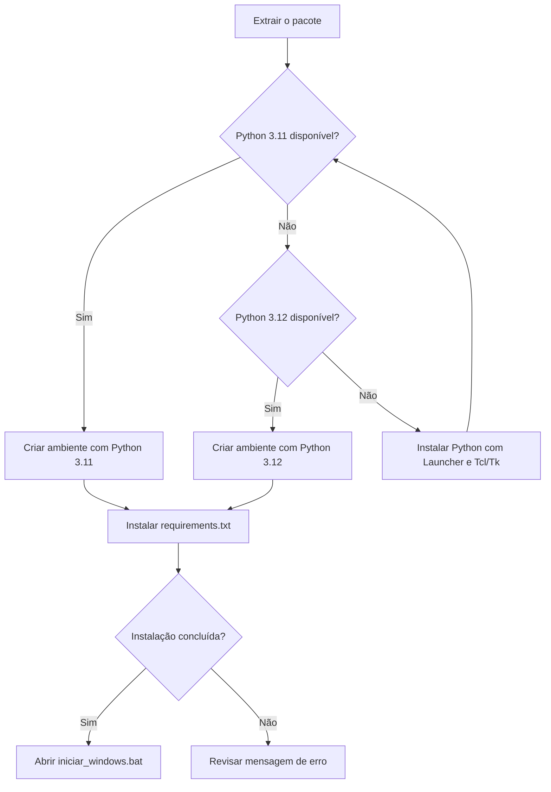
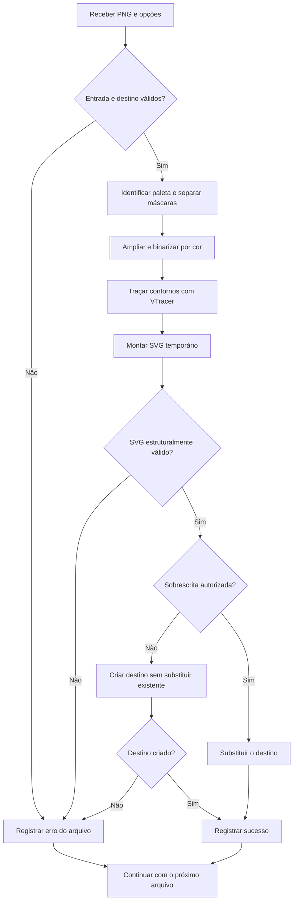

# Conversor PNG para SVG

Aplicativo Python para transformar imagens PNG em **curvas e formas vetoriais editáveis**, com interface gráfica em português e uso opcional pela linha de comando. O processamento é local e funciona offline depois da instalação das dependências.

O fluxo foi pensado principalmente para **logotipos, ícones e ilustrações com cores sólidas**, incluindo artes brancas sobre fundo transparente. O SVG gerado mantém as dimensões originais, usa `viewBox` para permitir redimensionamento e contém caminhos vetoriais, sem incorporar o PNG.

> **Python mínimo: 3.11. Base recomendada para reproduzir a validação: Python 3.12, de 64 bits.**
>
> **Windows: funcionamento confirmado pelo usuário.** A versão exata do Python usada nessa confirmação não foi informada. Os testes automatizados e as conversões de referência foram executados com Python 3.12 no Linux.

## Sumário

- [Requisitos e versões do Python](#requisitos-e-versões-do-python)
- [Por que manter Python 3.12 neste projeto?](#por-que-manter-python-312-neste-projeto)
- [Instalação no Windows](#instalação-no-windows)
- [Uso pela interface gráfica](#uso-pela-interface-gráfica)
- [Qualidade, cores e transparência](#qualidade-cores-e-transparência)
- [Uso pela linha de comando](#uso-pela-linha-de-comando)
- [Como a conversão funciona](#como-a-conversão-funciona)
- [Gravação e preservação dos arquivos](#gravação-e-preservação-dos-arquivos)
- [Estrutura do projeto](#estrutura-do-projeto)
- [Integração com outro código Python](#integração-com-outro-código-python)
- [Testes e validação](#testes-e-validação)
- [Limitações e resultados esperados](#limitações-e-resultados-esperados)
- [Solução de problemas](#solução-de-problemas)
- [Dependências e referências](#dependências-e-referências)

## Requisitos e versões do Python

O requisito mínimo é determinado pelo conjunto de dependências fixado em `requirements.txt`. Neste pacote, o **NumPy 2.3.5 exige Python 3.11 ou superior**. Isso estabelece o mínimo técnico; não significa que todas as versões posteriores do Python tenham sido testadas com o aplicativo.

| Item                      | Requisito ou orientação                                                        |
| ------------------------- | ------------------------------------------------------------------------------ |
| Python mínimo             | **CPython 3.11**                                                               |
| Python recomendado        | **CPython 3.12 de 64 bits**, base usada na validação automatizada              |
| Inicializador automático  | Procura Python **3.11** primeiro e, se não encontrar, tenta **3.12**           |
| Python 3.10 ou anterior   | Incompatível com as dependências fixadas deste pacote                          |
| Python 3.13 ou posterior  | Fora da validação deste projeto e da seleção atual do instalador automático    |
| Ambiente principal de uso | Windows com Python e Tcl/Tk instalados                                         |
| Interface gráfica         | Tkinter, componente do Python com suporte Tcl/Tk; não é instalado pelo `pip`   |
| Processamento             | CPU; a conversão não depende de GPU                                            |
| Conexão com a internet    | Necessária para baixar as dependências na instalação; dispensável na conversão |
| Pasta de saída            | Deve permitir gravação; prefira uma pasta local em NTFS no Windows             |

A memória necessária varia conforme a resolução, a qualidade e a quantidade de cores. A qualidade alta amplia as máscaras em quatro vezes na largura e na altura, criando **16 vezes mais pixels intermediários**. Não foi estabelecido um mínimo de RAM por benchmark; use os limites documentados adiante e reduza a qualidade quando necessário.

**Se Python 3.11 e 3.12 estiverem instalados juntos, o `.bat` atual escolherá o 3.11.** Para selecionar o 3.12 explicitamente, siga a instalação manual. Não é necessário remover outras versões do Python.

## Por que manter Python 3.12 neste projeto?

> **Para uso imediato, mantenha Python 3.12 de 64 bits e as dependências fixadas. Versões superiores não estão proibidas: ainda precisam ser validadas com este aplicativo.**

A recomendação tem motivos verificáveis, sem presumir que uma versão mais recente seja instável ou incompatível:

1. **A aplicação foi testada nesse ambiente.** Os testes automatizados, o processamento dos logotipos e a inspeção das saídas foram realizados com Python 3.12. Trocar o interpretador altera uma parte do ambiente de execução, mesmo mantendo o mesmo código e `requirements.txt`.
2. **O instalador atual só seleciona 3.11 e 3.12.** Se houver apenas Python 3.13 ou posterior, `instalar_windows.bat` não tentará utilizá-lo e exibirá a orientação para instalar uma das versões previstas. Essa restrição está no instalador; não comprova uma incompatibilidade do motor de conversão.
3. **Há dependências com código nativo.** NumPy contém componentes compilados e o VTracer utiliza uma extensão nativa baseada em Rust. A instalação depende de pacotes binários, chamados _wheels_, compatíveis com o interpretador, o sistema operacional e a arquitetura. Fixar a versão da biblioteca não torna um binário válido para qualquer Python.
4. **Compatibilidade de dependência não é validação do aplicativo.** Algumas dependências já publicam wheels para Python superiores, inclusive no Windows. Isso é favorável à migração, mas não substitui a verificação conjunta da interface, dos processos, dos nomes de arquivos, dos erros e do resultado vetorial.

Portanto, a justificativa para não migrar automaticamente é **preservar o ambiente conhecido enquanto a nova combinação não foi testada**. Não foi demonstrado um defeito específico que impeça este conversor de funcionar em Python 3.13 ou 3.14. Também não se afirma que essas versões sejam menos seguras, mais lentas ou incapazes de instalar as dependências.

### Como validar uma versão superior

Quem desejar avaliar outra versão deve criar um ambiente separado, mantendo a `.venv` de uso atual. Por exemplo, com Python 3.13 já instalado:

```powershell
py -3.13 -m venv .venv-validacao313
.\.venv-validacao313\Scripts\python.exe -m pip install --only-binary=:all: -r requirements.txt
.\.venv-validacao313\Scripts\python.exe -m unittest discover -s tests -v
.\.venv-validacao313\Scripts\python.exe converter_png_svg.py
```

O parâmetro `--only-binary=:all:` verifica se o índice configurado oferece os binários necessários, sem recorrer a uma compilação local. Uma falha nessa etapa pode indicar ausência de wheel para aquela combinação de plataforma e interpretador, ou um problema no acesso ao índice; isoladamente, não prova incompatibilidade do código Python.

Depois dos testes automatizados, confira a abertura da interface, a seleção de vários PNGs, as artes brancas e azuis, o fundo transparente, as dimensões da saída e os casos de SVG existente. Só então adote o novo ambiente e atualize a documentação e o instalador.

**Atualizações de manutenção dentro da série escolhida também devem ser acompanhadas dos testes.** A indicação de 3.12 é uma base de reprodução deste pacote, não uma recomendação para permanecer indefinidamente em uma versão sem manutenção.

## Instalação no Windows

### Caminho rápido

1. Instale Python **3.11 ou 3.12 de 64 bits**, usando uma distribuição com **Python Launcher** e **Tcl/Tk**. O instalador oficial está em [Python para Windows](https://www.python.org/downloads/windows/).
2. Extraia todo o pacote ZIP para uma pasta, por exemplo `C:\Projetos\Conversor_PNG_SVG`.
3. Dentro dessa pasta, execute **`instalar_windows.bat`** e aguarde a conclusão.
4. Execute **`iniciar_windows.bat`** para abrir o aplicativo.

> **Execute o aplicativo a partir da pasta extraída.** Mantenha `converter_png_svg.py`, `requirements.txt` e a pasta `png_svg` juntos. Copiar somente o arquivo principal não é suficiente.

O instalador cria uma pasta `.venv` no projeto e instala nela as dependências fixadas. O inicializador abre a interface com `pythonw.exe`, sem manter uma janela de terminal aberta.

### Instalação manual com Python 3.12

Abra o PowerShell na pasta do projeto:

```powershell
cd "C:\Projetos\Conversor_PNG_SVG"

py -3.12 -m venv .venv
.\.venv\Scripts\python.exe -m pip install -r requirements.txt
.\.venv\Scripts\python.exe converter_png_svg.py
```

Para usar o mínimo suportado, troque apenas `py -3.12` por `py -3.11` na criação do ambiente. Os demais comandos continuam iguais.

**Não é necessário ativar a `.venv`.** Os exemplos usam diretamente o Python desse ambiente, evitando confusão com outras instalações e com políticas do PowerShell para scripts de ativação.

Se a `.venv` já existir, confira sua versão antes de tentar mudar o interpretador:

```powershell
.\.venv\Scripts\python.exe -c "import sys; print(sys.executable); print(sys.version)"
```

Para recriar o ambiente com outra versão, feche o aplicativo e renomeie a pasta `.venv` existente antes de executar novamente a criação. Não altere um ambiente compartilhado com outros projetos.

### Fluxo de instalação



O diagrama representa o comportamento de `instalar_windows.bat`. A instalação manual permite escolher diretamente o Python 3.12.

## Uso pela interface gráfica

Ao abrir o aplicativo, clique em **Selecionar arquivos PNG…** e escolha um ou vários arquivos. Depois, informe a pasta de saída ou deixe esse campo vazio para salvar cada SVG ao lado do respectivo PNG.

Escolha a qualidade e o máximo de cores. Para começar com logotipos semelhantes aos usados na validação, mantenha **qualidade alta** e **8 cores**. Clique em **Converter arquivos** e acompanhe o andamento pela barra de progresso e pelo registro de resultados.

| Controle                     | Comportamento                                                                |
| ---------------------------- | ---------------------------------------------------------------------------- |
| Selecionar arquivos PNG      | Define a lista de imagens da próxima conversão                               |
| Pasta de saída               | Recebe os SVGs; vazia significa usar a pasta de cada PNG                     |
| Qualidade                    | Define a escala intermediária das máscaras                                   |
| Máximo de cores              | Limita a paleta entre 1 e 32 cores                                           |
| Sobrescrever SVGs existentes | Autoriza substituir um destino somente após validar a nova saída             |
| Registro de resultados       | Mostra o destino, as formas, as cores e o tamanho, ou o erro de cada arquivo |

Os arquivos são processados **sequencialmente**. Uma falha em um arquivo é registrada e o lote continua com os próximos. A barra de progresso avança por arquivo concluído, sem estimar o percentual interno da vetorização de uma imagem.

A interface aguarda o fim do lote antes de permitir o fechamento. O tempo limite padrão é **240 segundos por arquivo**; a configuração desse prazo está disponível pela CLI.

## Qualidade, cores e transparência

### Qualidade e limites de resolução

A escala intermediária melhora o ajuste dos contornos, mas não recupera detalhes ausentes na imagem original. A qualidade alta também pode produzir arquivos maiores e exigir mais memória.

| Qualidade na CLI | Escala por dimensão | Pixels intermediários | Limite efetivo de entrada    |
| ---------------- | ------------------- | --------------------- | ---------------------------- |
| `rapida`         | 1×                  | 1×                    | Até **20 milhões de pixels** |
| `equilibrada`    | 2×                  | 4×                    | Até **8 milhões de pixels**  |
| `alta`           | 4×                  | 16×                   | Até **2 milhões de pixels**  |

Esses limites combinam as duas regras do código: até **20 milhões de pixels na entrada** e até **32 milhões após a ampliação**. Pixels são calculados por `largura × altura`, e não pelo tamanho do PNG em megabytes. Os limites não garantem tempo de execução nem consumo fixo de memória.

Por exemplo, uma imagem de `2048 × 610` tem 1.249.280 pixels e cabe na qualidade alta. Uma imagem de `3000 × 2000` tem 6 milhões de pixels: cabe em `equilibrada`, mas ultrapassa o limite de `alta`.

### Paleta de cores

O número informado é um **máximo**, não uma quantidade obrigatória de cores na saída. Quando a imagem tem duas cores predominantes, informar oito permite que o aplicativo identifique essas duas, sem obrigar a criação das demais.

A descoberta da paleta usa preferencialmente os pixels totalmente opacos e, na ausência deles, os pixels com opacidade de pelo menos 128 em 255. O algoritmo seleciona uma amostra de até aproximadamente 200 mil pixels, quantiza os tons e mantém cores originais predominantes de cada grupo.

Tons próximos podem ser unificados. Grupos residuais abaixo de aproximadamente **0,1% da amostra** podem ser descartados para reduzir manchas das bordas suavizadas. Isso também pode eliminar detalhes de cores muito pequenas. O resultado não é uma garantia de reprodução colorimétrica exata.

### Fundo transparente e artes brancas

**O fundo transparente é preservado.** Artes brancas são vetorizadas normalmente; para visualizá-las, abra o SVG sobre um fundo escuro no editor ou na página em que será utilizado.

Semitransparências são simplificadas por um limiar de opacidade próximo a **50%**. Sombras suaves, brilhos e transparências graduais não são reproduzidos com a mesma composição de pixels do PNG.

## Uso pela linha de comando

Execute os exemplos na pasta do projeto, após instalar as dependências. Caminhos com espaços devem permanecer entre aspas.

### Converter uma imagem

```powershell
.\.venv\Scripts\python.exe converter_png_svg.py "C:\Imagens\logo.png"
```

A saída será `C:\Imagens\logo.svg`. O PNG original permanece intacto.

### Converter vários arquivos para uma pasta

```powershell
.\.venv\Scripts\python.exe converter_png_svg.py "C:\Imagens\logo_azul.png" "C:\Imagens\logo_branco.png" --saida "C:\SVGs" --qualidade alta --cores 8
```

**`--saida` recebe uma pasta, não o nome de um arquivo SVG.** A pasta é criada durante a gravação, se necessário e se houver permissão.

### Ajustar o prazo ou substituir uma saída existente

```powershell
.\.venv\Scripts\python.exe converter_png_svg.py "C:\Imagens\logo.png" --qualidade equilibrada --timeout 480

.\.venv\Scripts\python.exe converter_png_svg.py "C:\Imagens\logo.png" --sobrescrever
```

### Converter todos os PNGs de uma pasta no PowerShell

```powershell
$arquivosPNG = @(Get-ChildItem "C:\Imagens" -Filter *.png -File | Select-Object -ExpandProperty FullName)
if ($arquivosPNG.Count -gt 0) {
    & .\.venv\Scripts\python.exe converter_png_svg.py @arquivosPNG --saida "C:\SVGs"
}
```

Esse exemplo considera os arquivos da pasta indicada, sem percorrer subpastas. Para lotes extensos, respeite o limite de tamanho da linha de comando do sistema e divida a execução quando necessário.

### Referência dos argumentos

| Argumento        | Padrão           | Finalidade                                      |
| ---------------- | ---------------- | ----------------------------------------------- |
| `arquivos`       | Nenhum           | Um ou mais PNGs; sem arquivos, abre a interface |
| `--saida`        | Pasta da entrada | Pasta dos arquivos SVG                          |
| `--qualidade`    | `alta`           | `rapida`, `equilibrada` ou `alta`               |
| `--cores`        | `8`              | Limite inteiro entre `1` e `32`                 |
| `--sobrescrever` | Desativado       | Autoriza substituir os SVGs existentes          |
| `--timeout`      | `240`            | Tempo limite positivo por arquivo, em segundos  |
| `--help` ou `-h` | —                | Mostra a ajuda e encerra                        |

O código de saída é **0** quando todas as conversões terminam com sucesso e **1** quando alguma conversão falha. Erros de argumentos são tratados pelo `argparse`, com código **2**.

## Como a conversão funciona

O aplicativo transforma os contornos de regiões de cor em curvas. Essa abordagem gera objetos editáveis no SVG, com um resultado adequado principalmente a imagens de cores sólidas.

Primeiro, Pillow verifica o conteúdo do PNG, suas dimensões e a existência de animação. NumPy auxilia na descoberta da paleta e na separação de uma máscara de opacidade por cor. Cada máscara é ampliada conforme a qualidade e binarizada; em seguida, VTracer traça os contornos como caminhos vetoriais.

Os caminhos são reunidos em um SVG com as dimensões originais e as respectivas cores. Antes da gravação definitiva, a saída passa por validação estrutural: raiz SVG, `viewBox`, caminhos vetoriais e ausência de elementos ou referências não permitidos pelo gerador.

### Fluxo de processamento



O processamento roda em um **processo separado**, acionado pelo serviço da aplicação. Na interface, uma thread coordena o lote e comunica os resultados à janela por uma fila. O limite de tempo é aplicado individualmente a cada conversão.

## Gravação e preservação dos arquivos

O nome da saída deriva da entrada: `marca.png` gera `marca.svg`. O aplicativo não altera o PNG e, por padrão, recusa um SVG que já exista no destino.

Com sobrescrita autorizada, a nova versão é gerada e validada em um arquivo temporário antes de substituir a anterior. Assim, uma falha de leitura ou de validação anterior à substituição preserva o SVG existente.

No modo sem sobrescrita, o temporário validado é publicado por criação exclusiva usando **hard link**. Esse mecanismo evita substituir um destino que tenha surgido entre a verificação inicial e a gravação. No Windows, prefira uma pasta local em **NTFS**. Sistemas de arquivos ou compartilhamentos que não suportam hard links podem retornar erro nesse modo.

Os temporários são normalmente removidos ao terminar a tentativa. Uma interrupção forçada do processo, como um timeout, pode deixar arquivos temporários remanescentes; não há limpeza automática posterior implementada.

> **Atenção a nomes repetidos:** dois PNGs chamados `logo.png`, provenientes de pastas diferentes, produzirão o mesmo `logo.svg` se enviados à mesma pasta de saída. Use nomes distintos ou pastas separadas. O aplicativo não acrescenta sufixos automaticamente.

## Estrutura do projeto

| Arquivo ou diretório       | Responsabilidade                                                  |
| -------------------------- | ----------------------------------------------------------------- |
| `converter_png_svg.py`     | Entrada principal, argumentos e seleção do modo gráfico ou CLI    |
| `png_svg/gui.py`           | Interface Tkinter, seleção de arquivos, progresso e resultados    |
| `png_svg/service.py`       | Processo de conversão, timeout e tratamento centralizado de erros |
| `png_svg/worker.py`        | Recebimento do pedido e devolução do resultado em JSON            |
| `png_svg/images.py`        | Leitura do PNG, limites de pixels e descoberta da paleta          |
| `png_svg/vectorizer.py`    | Máscaras por cor e vetorização pelo VTracer                       |
| `png_svg/svg_files.py`     | Validação estrutural e gravação do SVG                            |
| `tests/test_conversion.py` | Testes de comportamento e proteção dos arquivos                   |
| `requirements.txt`         | Versões fixadas das dependências                                  |
| `instalar_windows.bat`     | Criação da `.venv` e instalação no Windows                        |
| `iniciar_windows.bat`      | Abertura da interface com o Python do ambiente                    |
| `VALIDACAO.md`             | Registro técnico da validação inicial                             |
| `README.md`                | Requisitos, instalação, uso e operação                            |

Mantenha a pasta `.venv` específica de cada computador. Para mover o projeto para outra máquina, copie o código e recrie o ambiente usando a instalação.

## Integração com outro código Python

Para reaproveitar o conversor em um script dentro da pasta do projeto, utilize o serviço, que mantém o isolamento do processo e o timeout:

```python
from png_svg.service import ConversionError, run_conversion

try:
    resultado = run_conversion(
        source=r"C:\Imagens\logo.png",
        output=r"C:\SVGs\logo.svg",
        quality="alta",
        colors=8,
        overwrite=False,
        timeout=240,
    )
    print(resultado["output"])
    print(resultado["paths"], "formas vetoriais")
except ConversionError as erro:
    print(f"Não foi possível converter: {erro}")
```

Os parâmetros dessa API estão em inglês, enquanto as opções da CLI estão em português. A função devolve um dicionário com `ok`, `output`, `width`, `height`, `paths`, `colors` e `bytes`. O projeto é distribuído como código-fonte; não foi empacotado para instalação por `pip install .`.

## Testes e validação

Na pasta do projeto, execute:

```powershell
.\.venv\Scripts\python.exe -m unittest discover -s tests -v
```

A validação inicial aprovou **15 testes automatizados**, cobrindo entradas inválidas, PNG animado, transparência, limites de pixels, cores, SVG vetorial, caminhos com acentos, timeout, sobrescrita e preservação do arquivo anterior.

Também foram convertidos quatro logotipos de referência. Cada saída apresentou **28 caminhos vetoriais, duas cores e nenhum PNG embutido**, mantendo as dimensões originais. As saídas foram renderizadas e inspecionadas visualmente; o registro detalhado está em [VALIDACAO.md](VALIDACAO.md).

Posteriormente, em **18/10/2026**, o usuário confirmou o funcionamento do aplicativo no **Windows**. Essa confirmação complementa os testes em Linux com Python 3.12, mas não representa uma matriz de testes de todas as versões do Windows ou do Python.

## Limitações e resultados esperados

**A vetorização é uma aproximação.** Em artes com contornos definidos e poucas cores, o resultado tende a ser mais fácil de editar. Fotografias, degradês, texturas e sombras podem perder detalhes, gerar muitas formas ou produzir um SVG maior que o PNG original.

- **Texto vira contorno:** não há OCR, identificação de fonte nem geração de texto tipográfico editável.
- **A paleta é simplificada:** tons próximos e detalhes muito pequenos podem ser unificados ou descartados.
- **Transparência gradual é simplificada:** o fundo transparente é preservado, mas efeitos suaves são tratados por limiar.
- **PNG animado é recusado:** exporte um quadro estático antes de converter.
- **Resolução continua relevante:** aumentar a escala de processamento não recupera informação ausente no original.
- **O lote é sequencial:** a seleção múltipla não implica processamento simultâneo.
- **O resultado pode precisar de revisão:** abra o SVG em um editor vetorial antes de utilizá-lo em uma aplicação que exija reprodução rigorosa da marca.

## Solução de problemas

| Sintoma ou mensagem                         | Causa provável                                         | Como resolver                                                                                          |
| ------------------------------------------- | ------------------------------------------------------ | ------------------------------------------------------------------------------------------------------ |
| `py` não é reconhecido                      | Python Launcher ausente ou indisponível                | Repare a instalação do Python com Launcher ou crie a `.venv` usando o caminho completo do `python.exe` |
| Instalador não encontra Python              | Somente outra versão está instalada                    | Instale 3.11 ou 3.12, ou selecione explicitamente um interpretador compatível na instalação manual     |
| Falha ao instalar NumPy                     | Python abaixo do mínimo ou distribuição incompatível   | Confira a versão e use CPython 3.11 ou 3.12 de 64 bits                                                 |
| `No module named PIL`, `numpy` ou `vtracer` | Ambiente errado ou instalação incompleta               | Execute o `pip install -r requirements.txt` pelo Python da `.venv`                                     |
| `No module named png_svg`                   | Pasta do pacote ausente ou código copiado parcialmente | Extraia o ZIP completo e preserve a estrutura original                                                 |
| Erro de Tkinter ou Tcl/Tk                   | Componente gráfico ausente                             | Repare a instalação do Python com suporte Tcl/Tk; a CLI pode ser usada sem a interface                 |
| Interface não abre ou fecha imediatamente   | Erro fica oculto ao iniciar com `pythonw.exe`          | Abra pelo terminal com o comando abaixo para visualizar o diagnóstico                                  |
| `O destino já existe`                       | Sobrescrita desativada                                 | Escolha outro destino ou autorize sobrescrever a saída                                                 |
| Erro de hard link                           | Pasta sem suporte ou permissão para esse recurso       | Use uma pasta local NTFS; o modo de sobrescrita usa outro mecanismo de publicação                      |
| `PermissionError`                           | Pasta sem permissão ou destino bloqueado               | Escolha uma pasta gravável e verifique se o arquivo está bloqueado por outro programa                  |
| `Imagem acima do limite de pixels`          | A resolução excede o limite da qualidade escolhida     | Troque de `alta` para `equilibrada` ou `rapida`, ou reduza a imagem                                    |
| `Tempo limite ... excedido`                 | Vetorização não terminou no prazo                      | Reduza qualidade ou cores; pela CLI, aumente `--timeout`                                               |
| SVG parece vazio                            | Arte branca aberta sobre fundo branco                  | Visualize o arquivo sobre um fundo escuro                                                              |
| `não contém pixels ...`                     | Nenhum pixel atinge o limiar de opacidade              | Verifique a opacidade do PNG e exporte uma versão adequada ao limiar usado                             |
| Cores ou contornos diferentes do esperado   | Simplificação da paleta ou limites do traçado          | Revise a qualidade, o máximo de cores e a imagem de origem; ajustes manuais podem ser necessários      |

Para investigar uma falha de inicialização:

```powershell
.\.venv\Scripts\python.exe converter_png_svg.py
```

Para conferir o ambiente e as dependências:

```powershell
.\.venv\Scripts\python.exe --version
.\.venv\Scripts\python.exe -m pip show Pillow numpy vtracer
.\.venv\Scripts\python.exe -m pip check
```

Para verificar o Tkinter na versão recomendada:

```powershell
py -3.12 -m tkinter
```

Esse último comando deve abrir a janela de demonstração do Tkinter.

## Dependências e referências

| Dependência                                         | Versão no pacote                           | Uso                                                 |
| --------------------------------------------------- | ------------------------------------------ | --------------------------------------------------- |
| [Pillow](https://pypi.org/project/pillow/12.3.0/)   | `12.3.0`                                   | Leitura, validação e redimensionamento das máscaras |
| [NumPy](https://pypi.org/project/numpy/2.3.5/)      | `2.3.5`                                    | Paleta, classificação de pixels e máscaras          |
| [VTracer](https://pypi.org/project/vtracer/0.6.15/) | `0.6.15`                                   | Traçado de contornos em caminhos vetoriais          |
| Tkinter                                             | Incluído na distribuição Python com Tcl/Tk | Interface gráfica                                   |
| Biblioteca padrão Python                            | Incluída no Python                         | CLI, processos, XML, temporários e testes           |

As versões fixadas reproduzem o conjunto usado na implementação. Atualizações de dependências devem ser acompanhadas da execução dos testes e de uma comparação visual com imagens de referência. CairoSVG foi usado na inspeção das saídas durante a validação; não é uma dependência de execução do aplicativo.

Referências oficiais:

- [Python para Windows](https://www.python.org/downloads/windows/)
- [Ambientes virtuais com venv](https://docs.python.org/3.12/library/venv.html)
- [Tkinter e Tcl/Tk](https://docs.python.org/3.12/library/tkinter.html)
- [Código e documentação do VTracer](https://github.com/visioncortex/vtracer)

Os diagramas deste README usam blocos `mermaid`. Eles são renderizados em visualizadores com suporte ao formato, como o GitHub; um editor de texto simples mostrará o código dos diagramas.

---

Documentação revisada em **20/10/2026**, com base no pacote do aplicativo, na validação inicial e na confirmação de uso no Windows.
